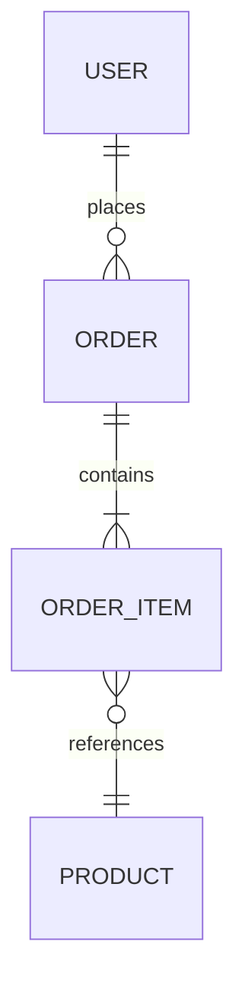

# DynamoDB Schema Designer

Guide users through designing a new DynamoDB schema from access patterns.

## Workflow

### Step 1: Gather Access Patterns

Ask user to list ALL queries their application will perform:

"List every query your application needs:
- Get [entity] by [key]
- List [entities] for [parent]
- Find [entities] where [condition]

Example: Get user by ID, List orders for user, Find orders by status"

### Step 2: Identify Entities and Relationships

From access patterns, document:
- **Entities**: User, Order, Product, etc.
- **Relationships**: 1:1, 1:N, M:N

**Generate ERD** to validate understanding:



### Step 3: Design Primary Keys

Apply single-table design:

```
Entity: User       → PK: USER#<id>     SK: PROFILE
Entity: Order      → PK: USER#<id>     SK: ORDER#<orderId>
Entity: OrderItem  → PK: ORDER#<id>    SK: ITEM#<productId>
```

Validate each access pattern can use Query (not Scan).

### Step 4: Design GSIs

For patterns not served by primary key:
- Use GSI overloading (GSI1PK, GSI1SK)
- Consider sparse GSIs for rare attributes
- Minimize GSI count (each costs write capacity)

### Step 5: Create Sample Data

Write example items to validate design:

```
| PK          | SK           | GSI1PK         | GSI1SK          |
|-------------|--------------|----------------|-----------------|
| USER#123    | PROFILE      | EMAIL#a@b.com  | USER#123        |
| USER#123    | ORDER#001    | STATUS#pending | DATE#2024-01-15 |
| ORDER#001   | ITEM#SKU-A   |                |                 |
```

**Generate Table Layout** to visualize item collections:

```
┌─ Item Collection: USER#123 ─────────────────────────────────┐
│                                                             │
│  PK          │ SK           │ Type    │ Attributes          │
│  ────────────┼──────────────┼─────────┼──────────────────── │
│  USER#123    │ PROFILE      │ User    │ name, email         │
│  USER#123    │ ORDER#001    │ Order   │ total, status       │
│  USER#123    │ ORDER#002    │ Order   │ total, status       │
│                                                             │
└─────────────────────────────────────────────────────────────┘

┌─ Item Collection: ORDER#001 ────────────────────────────────┐
│                                                             │
│  PK          │ SK           │ Type      │ Attributes        │
│  ────────────┼──────────────┼───────────┼────────────────── │
│  ORDER#001   │ ITEM#SKU-A   │ OrderItem │ qty, price        │
│  ORDER#001   │ ITEM#SKU-B   │ OrderItem │ qty, price        │
│                                                             │
└─────────────────────────────────────────────────────────────┘
```

### Step 6: Verify All Patterns

Map each pattern to its query:

| Access Pattern | Table/Index | Query |
|---------------|-------------|-------|
| Get user | Base | PK=USER#id, SK=PROFILE |
| User's orders | Base | PK=USER#id, SK begins_with ORDER# |
| Orders by status | GSI1 | GSI1PK=STATUS#pending |

**Every pattern must use Query, never Scan.**

### Step 7: Generate Schema

Output in user's preferred format:
- CDK (TypeScript/Python)
- CloudFormation YAML
- Terraform
- AWS CLI JSON

## Checklist

Before completing:
- [ ] All access patterns documented
- [ ] ERD generated and validated
- [ ] Single-table design applied
- [ ] Every pattern uses Query
- [ ] GSIs overloaded where possible
- [ ] Sample data validates design
- [ ] Table layout diagram generated

## Diagram Reference

See [references/diagrams.md](references/diagrams.md) for diagram templates and examples.
