# DynamoDB Design Diagrams

Templates for generating schema visualizations.

> **Table Layout Options:** For detailed comparison of ASCII vs Mermaid Block formats, see [table-layout-options.md](table-layout-options.md)

## Entity-Relationship Diagram (ERD)

Use Mermaid ERD syntax to show entities and relationships before mapping to DynamoDB.

### Relationship Notation

| Symbol | Meaning |
|--------|---------|
| `\|\|` | Exactly one |
| `o\|` | Zero or one |
| `}o` | Zero or more |
| `}\|` | One or more |

### Template

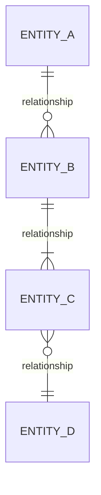

### E-Commerce Example

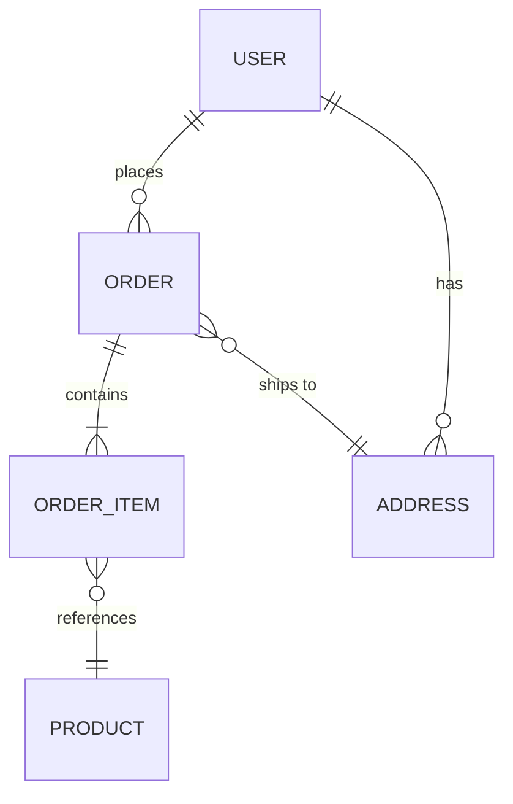

### Social Network Example

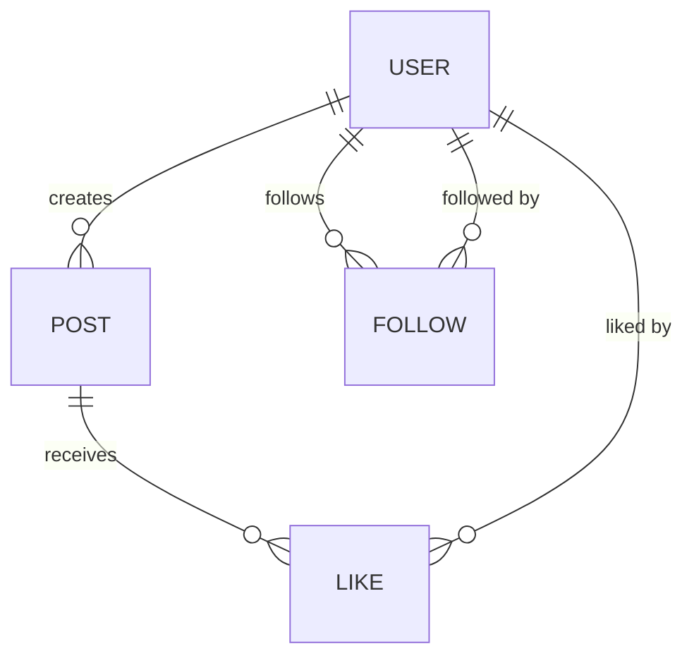

### Gaming Example

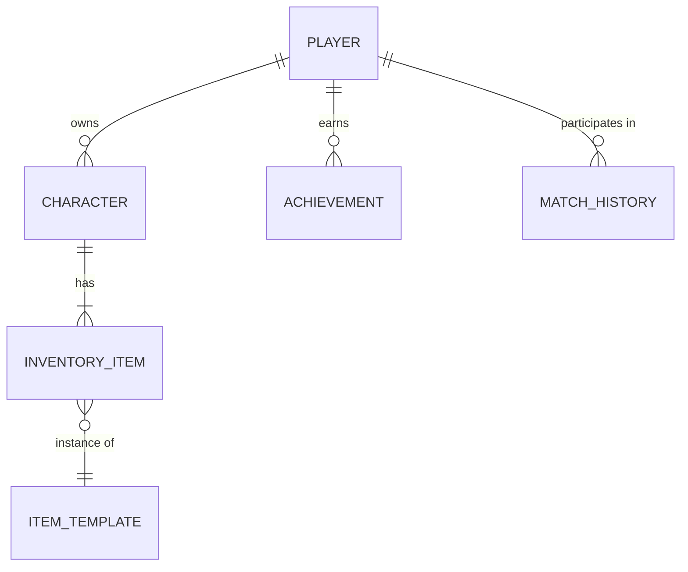

---

## Table Layout Diagram

ASCII visualization showing item collections grouped by partition key.

### Template

```
┌─ Item Collection: <PK_VALUE> ───────────────────────────────┐
│                                                             │
│  PK          │ SK           │ Type    │ Attributes          │
│  ────────────┼──────────────┼─────────┼──────────────────── │
│  <pk>        │ <sk1>        │ <type>  │ <attrs>             │
│  <pk>        │ <sk2>        │ <type>  │ <attrs>             │
│                                                             │
└─────────────────────────────────────────────────────────────┘
```

### E-Commerce Example

```
┌─ Item Collection: USER#u123 ────────────────────────────────┐
│                                                             │
│  PK          │ SK              │ Type    │ Attributes       │
│  ────────────┼─────────────────┼─────────┼───────────────── │
│  USER#u123   │ PROFILE         │ User    │ name, email      │
│  USER#u123   │ ADDRESS#home    │ Address │ street, city     │
│  USER#u123   │ ADDRESS#work    │ Address │ street, city     │
│  USER#u123   │ ORDER#o001      │ Order   │ total, status    │
│  USER#u123   │ ORDER#o002      │ Order   │ total, status    │
│                                                             │
└─────────────────────────────────────────────────────────────┘

┌─ Item Collection: ORDER#o001 ───────────────────────────────┐
│                                                             │
│  PK          │ SK              │ Type      │ Attributes     │
│  ────────────┼─────────────────┼───────────┼─────────────── │
│  ORDER#o001  │ META            │ OrderMeta │ date, address  │
│  ORDER#o001  │ ITEM#sku-a      │ OrderItem │ qty, price     │
│  ORDER#o001  │ ITEM#sku-b      │ OrderItem │ qty, price     │
│                                                             │
└─────────────────────────────────────────────────────────────┘
```

### Social Network Example

```
┌─ Item Collection: USER#u12345 ──────────────────────────────┐
│                                                             │
│  PK           │ SK             │ Type     │ Attributes      │
│  ─────────────┼────────────────┼──────────┼──────────────── │
│  USER#u12345  │ INFO           │ User     │ name, bio       │
│  USER#u12345  │ COUNT          │ Stats    │ posts, follows  │
│                                                             │
└─────────────────────────────────────────────────────────────┘

┌─ Item Collection: USER#u12345#follower ─────────────────────┐
│                                                             │
│  PK                   │ SK           │ Type    │ Attributes │
│  ─────────────────────┼──────────────┼─────────┼─────────── │
│  USER#u12345#follower │ USER#u999    │ Follow  │ since      │
│  USER#u12345#follower │ USER#u888    │ Follow  │ since      │
│                                                             │
└─────────────────────────────────────────────────────────────┘

┌─ Item Collection: POST#p001 ────────────────────────────────┐
│                                                             │
│  PK          │ SK             │ Type    │ Attributes        │
│  ────────────┼────────────────┼─────────┼────────────────── │
│  POST#p001   │ META           │ Post    │ content, author   │
│  POST#p001   │ LIKE#u999      │ Like    │ timestamp         │
│  POST#p001   │ LIKE#u888      │ Like    │ timestamp         │
│                                                             │
└─────────────────────────────────────────────────────────────┘
```

---

## GSI Visualization

Show how GSI projects data for secondary access patterns.

### Template

```
Base Table                          GSI1 (by email)
┌────────────┬──────────┐           ┌────────────────┬──────────┐
│ PK         │ SK       │           │ GSI1PK         │ GSI1SK   │
├────────────┼──────────┤           ├────────────────┼──────────┤
│ USER#123   │ PROFILE  │ ───────── │ EMAIL#a@b.com  │ USER#123 │
│ USER#456   │ PROFILE  │ ───────── │ EMAIL#x@y.com  │ USER#456 │
└────────────┴──────────┘           └────────────────┴──────────┘
```

### Overloaded GSI Example

```
Base Table                          GSI1 (overloaded)
┌────────────┬──────────┐           ┌─────────────────┬──────────────┐
│ PK         │ SK       │           │ GSI1PK          │ GSI1SK       │
├────────────┼──────────┤           ├─────────────────┼──────────────┤
│ USER#123   │ PROFILE  │ ───────── │ EMAIL#a@b.com   │ USER#123     │
│ USER#123   │ ORDER#1  │ ───────── │ STATUS#pending  │ 2024-01-15   │
│ PROD#sku-a │ INFO     │ ───────── │ CAT#electronics │ PRICE#299    │
└────────────┴──────────┘           └─────────────────┴──────────────┘

GSI1 serves multiple access patterns:
• Find user by email:    GSI1PK = EMAIL#...
• Find pending orders:   GSI1PK = STATUS#pending
• Products by category:  GSI1PK = CAT#electronics
```

---

## Access Pattern Matrix

Combine with diagrams to show which queries use which keys.

```
┌─────────────────────────┬───────────┬─────────────────────────────────┐
│ Access Pattern          │ Index     │ Key Condition                   │
├─────────────────────────┼───────────┼─────────────────────────────────┤
│ Get user profile        │ Base      │ PK=USER#id, SK=PROFILE          │
│ User's orders           │ Base      │ PK=USER#id, SK begins_with ORDER│
│ Order items             │ Base      │ PK=ORDER#id, SK begins_with ITEM│
│ Find user by email      │ GSI1      │ GSI1PK=EMAIL#...                │
│ Orders by status        │ GSI1      │ GSI1PK=STATUS#..., sort by date │
└─────────────────────────┴───────────┴─────────────────────────────────┘
```

---

## Access Pattern Flow

Mermaid flowchart showing how queries route through table and GSIs.

### Template

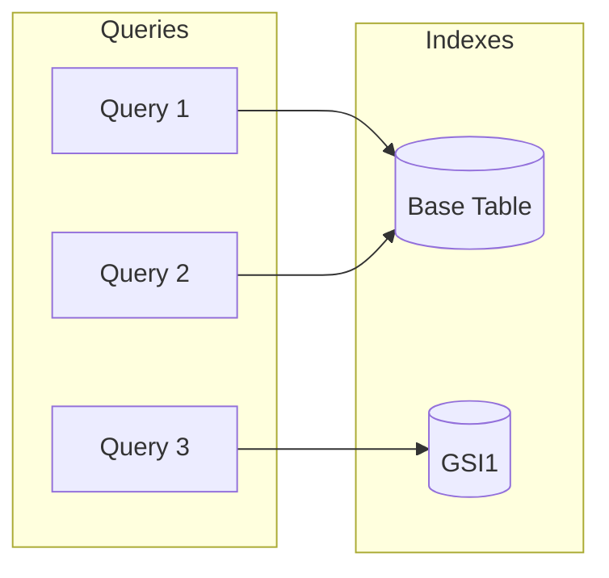

### E-Commerce Example

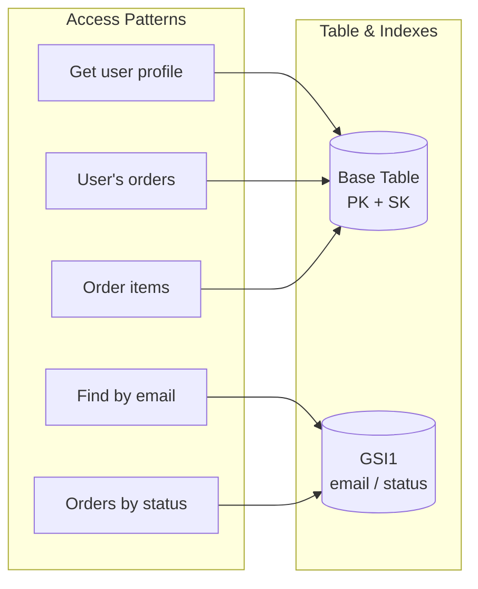

### Social Network Example

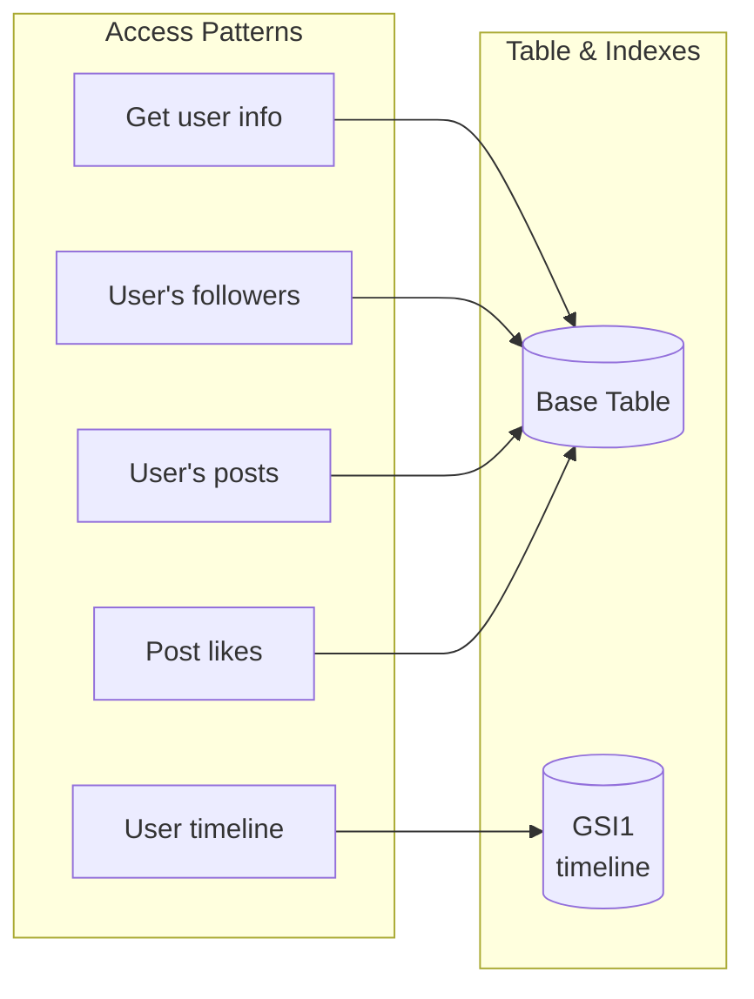

---

## Partition Distribution

ASCII visualization to identify hot partitions and sharding needs.

### Template

```
Partition Load Distribution
────────────────────────────────────────────────
<PK_VALUE>  <BAR>  <PERCENTAGE>  <STATUS>
```

### Healthy Distribution

```
Partition Load Distribution (Writes/sec)
────────────────────────────────────────────────
USER#001    ████████ 12%      ✅ OK
USER#002    ███████ 11%       ✅ OK
USER#003    ███████ 10%       ✅ OK
USER#004    ██████ 9%         ✅ OK
USER#005    ██████ 8%         ✅ OK
Others      ██████████████████████████████ 50%
────────────────────────────────────────────────
Distribution: EVEN - No sharding needed
```

### Hot Partition Warning

```
Partition Load Distribution (Writes/sec)
────────────────────────────────────────────────
COUNTER#global  ████████████████████████ 65%  ⚠️ HOT
USER#001        ████ 8%                       ✅ OK
USER#002        ███ 6%                        ✅ OK
USER#003        ███ 5%                        ✅ OK
Others          ████████ 16%
────────────────────────────────────────────────
⚠️  WARNING: COUNTER#global exceeds 20% threshold
    RECOMMENDATION: Apply write sharding (10 shards)

    Before: COUNTER#global
    After:  COUNTER#global#0, COUNTER#global#1, ... COUNTER#global#9
```

### Time-Series Hot Partition

```
Partition Load Distribution (Writes/sec)
────────────────────────────────────────────────
SENSOR#001#2024-01-25  ████████████████████ 45%  ⚠️ HOT
SENSOR#001#2024-01-24  ███ 5%                    ✅ OK
SENSOR#002#2024-01-25  ████████████ 25%          ⚠️ WARM
SENSOR#002#2024-01-24  ██ 3%                     ✅ OK
Others                 ██████████ 22%
────────────────────────────────────────────────
⚠️  WARNING: Current-day partitions are hot
    RECOMMENDATION: Consider table-per-period strategy

    Current: Single table with date in PK
    Better:  sensors-2024-01-25, sensors-2024-01-24, ...
```

---

## Architecture Diagram

Mermaid flowchart for DynamoDB event-driven architectures.

### OLTP + OLAP Pipeline

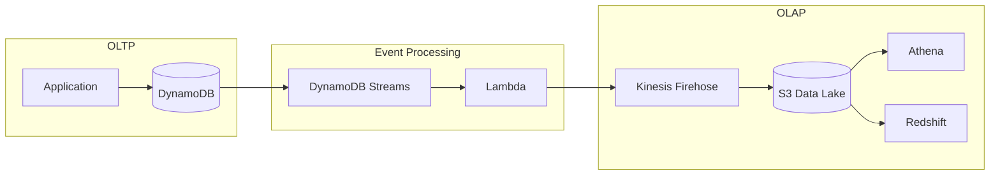

### Real-Time Aggregation

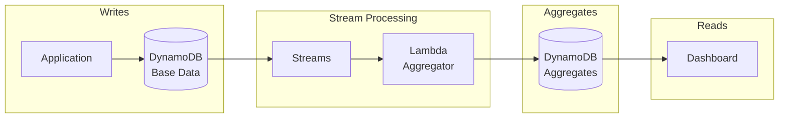

### Cross-Region Replication

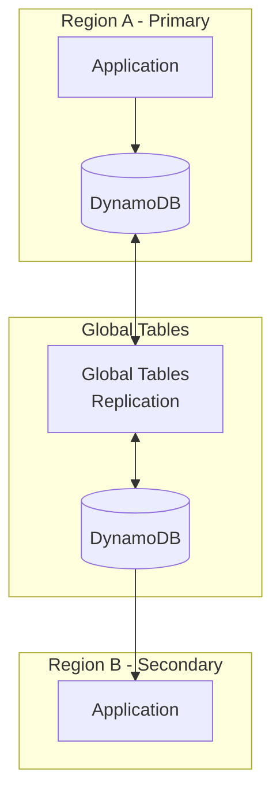

### Event-Driven Microservices

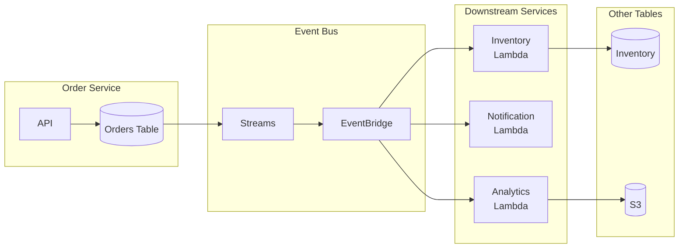
