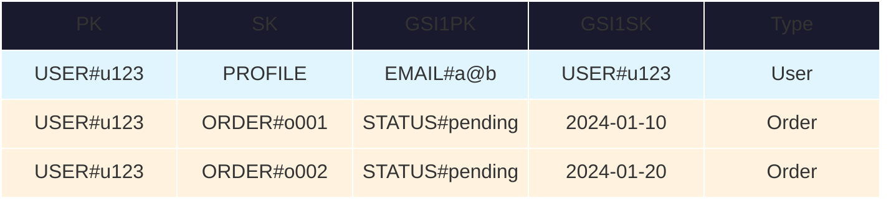
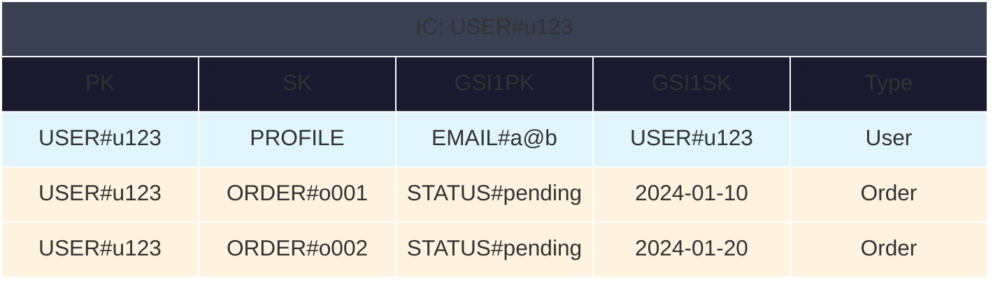
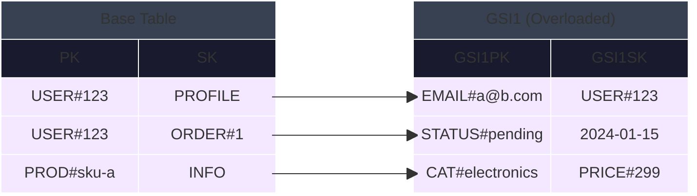
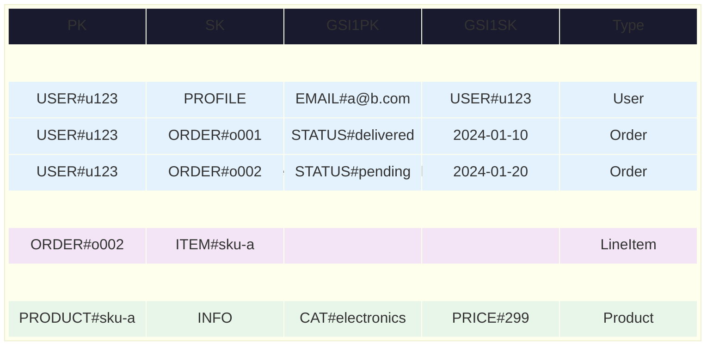

# DynamoDB Table Layout Templates

Deep-dive templates for table data visualization with both ASCII and Mermaid Block formats.

## Quick Reference

| Pattern | Use When |
|---------|----------|
| Simple Table | Basic schema visualization |
| Item Collection | Show PK groupings |
| Side-by-Side | Base table + GSI relationship |
| Full Schema | Complete table design |

## Mermaid Block Configuration

**Tight layout with minimal padding:**
```
%%{init: {"block": {"padding": 8}} }%%
```

**Eliminate gaps between cells** (stroke matches fill):
```
classDef myClass fill:#e1f5fe,stroke:#e1f5fe,stroke-width:7px
```

**Hide block labels** (keeps in code, invisible in render):
```
classDef nolabel color:transparent
class blockName nolabel
```

---

## Templates

### 1. Simple Table

#### ASCII

```
┌──────────────┬─────────────┬──────────────────┬────────────────┬──────────┐
│ PK           │ SK          │ GSI1PK           │ GSI1SK         │ Type     │
├──────────────┼─────────────┼──────────────────┼────────────────┼──────────┤
│ USER#u123    │ PROFILE     │ EMAIL#a@b.com    │ USER#u123      │ User     │
│ USER#u123    │ ORDER#o001  │ STATUS#delivered │ 2024-01-10     │ Order    │
│ USER#u123    │ ORDER#o002  │ STATUS#pending   │ 2024-01-20     │ Order    │
└──────────────┴─────────────┴──────────────────┴────────────────┴──────────┘
```

#### Mermaid Block



---

### 2. Item Collection

#### ASCII

```
┌─ Item Collection: USER#u123 ────────────────────────────────────────────────┐
│                                                                             │
│  PK          │ SK              │ GSI1PK           │ GSI1SK      │ Type      │
│  ────────────┼─────────────────┼──────────────────┼─────────────┼────────── │
│  USER#u123   │ PROFILE         │ EMAIL#a@b.com    │ USER#u123   │ User      │
│  USER#u123   │ ORDER#o001      │ STATUS#delivered │ 2024-01-10  │ Order     │
│  USER#u123   │ ORDER#o002      │ STATUS#pending   │ 2024-01-20  │ Order     │
│                                                                             │
└─────────────────────────────────────────────────────────────────────────────┘
```

#### Mermaid Block



---

### 3. Side-by-Side (Base + GSI)

#### ASCII

```
Base Table                          GSI1 (overloaded)
┌────────────┬──────────┐           ┌─────────────────┬──────────────┐
│ PK         │ SK       │           │ GSI1PK          │ GSI1SK       │
├────────────┼──────────┤           ├─────────────────┼──────────────┤
│ USER#123   │ PROFILE  │ ───────── │ EMAIL#a@b.com   │ USER#123     │
│ USER#123   │ ORDER#1  │ ───────── │ STATUS#pending  │ 2024-01-15   │
│ PROD#sku-a │ INFO     │ ───────── │ CAT#electronics │ PRICE#299    │
└────────────┴──────────┘           └─────────────────┴──────────────┘
```

#### Mermaid Block



---

### 4. Full Schema

#### ASCII

```
┌─ Base Table: ECommerceTable ────────────────────────────────────────────────┐
│                                                                             │
│  PK            │ SK              │ GSI1PK           │ GSI1SK      │ Type    │
│  ──────────────┼─────────────────┼──────────────────┼─────────────┼──────── │
│  USER#u123     │ PROFILE         │ EMAIL#a@b.com    │ USER#u123   │ User    │
│  USER#u123     │ ORDER#o001      │ STATUS#delivered │ 2024-01-10  │ Order   │
│  USER#u123     │ ORDER#o002      │ STATUS#pending   │ 2024-01-20  │ Order   │
│  ORDER#o002    │ ITEM#sku-a      │ -                │ -           │ LineItem│
│  PRODUCT#sku-a │ INFO            │ CAT#electronics  │ PRICE#299   │ Product │
│                                                                             │
└─────────────────────────────────────────────────────────────────────────────┘
```

#### Mermaid Block


