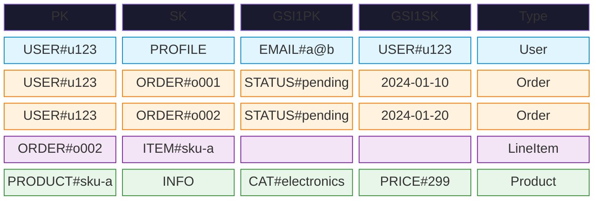
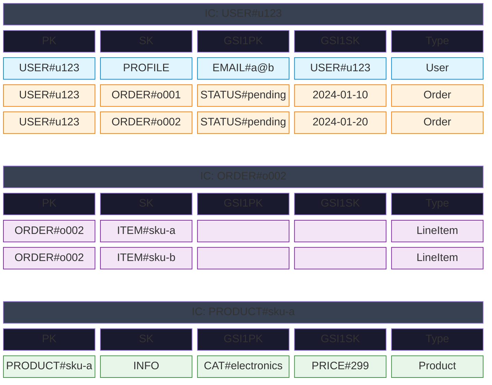
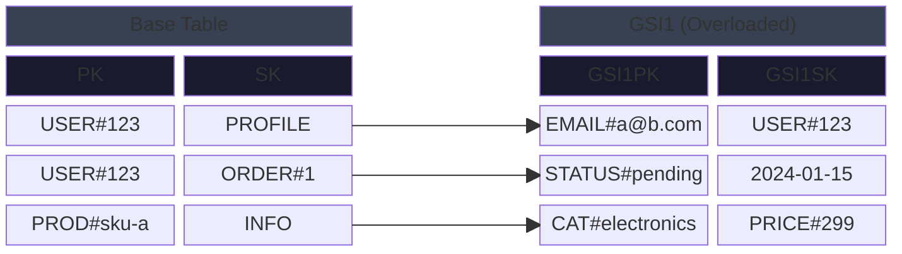
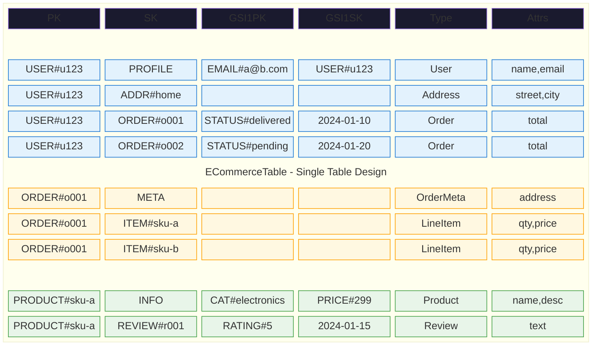

# DynamoDB Table Layout Diagram Options

Comparison of ASCII vs Mermaid Block for visualizing DynamoDB table structure.

## Quick Comparison

| Format | Pros | Cons | Best For |
|--------|------|------|----------|
| **ASCII** | Universal, precise control, no rendering deps | No color, manual alignment | Terminal, any environment |
| **Mermaid Block** | Color coding, rendered visual | Newer syntax, verbose | Documentation, presentations |

## Mermaid Block Configuration

Add this directive at the start for tight layout with minimal internal padding:

```
%%{init: {"block": {"padding": 8}} }%%
```

To hide block labels while keeping them in code:

```
classDef nolabel color:transparent
class blockName nolabel
```

---

## 1. Simple Table

### ASCII

```
┌──────────────┬─────────────┬──────────────────┬────────────────┬──────────┐
│ PK           │ SK          │ GSI1PK           │ GSI1SK         │ Type     │
├──────────────┼─────────────┼──────────────────┼────────────────┼──────────┤
│ USER#u123    │ PROFILE     │ EMAIL#a@b.com    │ USER#u123      │ User     │
│ USER#u123    │ ORDER#o001  │ STATUS#delivered │ 2024-01-10     │ Order    │
│ USER#u123    │ ORDER#o002  │ STATUS#pending   │ 2024-01-20     │ Order    │
│ ORDER#o002   │ ITEM#sku-a  │ -                │ -              │ LineItem │
│ PRODUCT#sku-a│ INFO        │ CAT#electronics  │ PRICE#299      │ Product  │
└──────────────┴─────────────┴──────────────────┴────────────────┴──────────┘
```

### Mermaid Block (Color-Coded)



---

## 2. Item Collection Grouping

### ASCII

```
┌─ Item Collection: USER#u123 ────────────────────────────────────────────────┐
│                                                                             │
│  PK          │ SK              │ GSI1PK           │ GSI1SK      │ Type      │
│  ────────────┼─────────────────┼──────────────────┼─────────────┼────────── │
│  USER#u123   │ PROFILE         │ EMAIL#a@b.com    │ USER#u123   │ User      │
│  USER#u123   │ ORDER#o001      │ STATUS#delivered │ 2024-01-10  │ Order     │
│  USER#u123   │ ORDER#o002      │ STATUS#pending   │ 2024-01-20  │ Order     │
│                                                                             │
└─────────────────────────────────────────────────────────────────────────────┘

┌─ Item Collection: ORDER#o002 ───────────────────────────────────────────────┐
│                                                                             │
│  PK          │ SK              │ GSI1PK           │ GSI1SK      │ Type      │
│  ────────────┼─────────────────┼──────────────────┼─────────────┼────────── │
│  ORDER#o002  │ ITEM#sku-a      │ -                │ -           │ LineItem  │
│  ORDER#o002  │ ITEM#sku-b      │ -                │ -           │ LineItem  │
│                                                                             │
└─────────────────────────────────────────────────────────────────────────────┘

┌─ Item Collection: PRODUCT#sku-a ────────────────────────────────────────────┐
│                                                                             │
│  PK            │ SK          │ GSI1PK          │ GSI1SK     │ Type         │
│  ──────────────┼─────────────┼─────────────────┼────────────┼───────────── │
│  PRODUCT#sku-a │ INFO        │ CAT#electronics │ PRICE#299  │ Product      │
│                                                                             │
└─────────────────────────────────────────────────────────────────────────────┘
```

### Mermaid Block (Color-Coded)

> **Note:** Spanning title rows cause wider horizontal spacing than Simple Table.



---

## 3. Base Table + GSI

### ASCII (Recommended for Side-by-Side)

```
Base Table                          GSI1 (overloaded)
┌────────────┬──────────┐           ┌─────────────────┬──────────────┐
│ PK         │ SK       │           │ GSI1PK          │ GSI1SK       │
├────────────┼──────────┤           ├─────────────────┼──────────────┤
│ USER#123   │ PROFILE  │ ───────── │ EMAIL#a@b.com   │ USER#123     │
│ USER#123   │ ORDER#1  │ ───────── │ STATUS#pending  │ 2024-01-15   │
│ PROD#sku-a │ INFO     │ ───────── │ CAT#electronics │ PRICE#299    │
└────────────┴──────────┘           └─────────────────┴──────────────┘

GSI1 serves multiple access patterns:
• Find user by email:    GSI1PK = EMAIL#...
• Find pending orders:   GSI1PK = STATUS#pending
• Products by category:  GSI1PK = CAT#electronics
```

### Mermaid Block (Side-by-Side with Links)

Uses a 5-column layout with space separators and arrow links showing the projection relationship:



---

## 4. Full Schema (E-Commerce)

### ASCII

```
┌─ Base Table: ECommerceTable ────────────────────────────────────────────────┐
│                                                                             │
│  PK            │ SK              │ GSI1PK           │ GSI1SK      │ Type    │
│  ──────────────┼─────────────────┼──────────────────┼─────────────┼──────── │
│  USER#u123     │ PROFILE         │ EMAIL#a@b.com    │ USER#u123   │ User    │
│  USER#u123     │ ORDER#o001      │ STATUS#delivered │ 2024-01-10  │ Order   │
│  USER#u123     │ ORDER#o002      │ STATUS#pending   │ 2024-01-20  │ Order   │
│  ORDER#o002    │ ITEM#sku-a      │ -                │ -           │ LineItem│
│  PRODUCT#sku-a │ INFO            │ CAT#electronics  │ PRICE#299   │ Product │
│                                                                             │
└─────────────────────────────────────────────────────────────────────────────┘

┌─ GSI1: Overloaded Index ────────────────────────────────────────────────────┐
│                                                                             │
│  GSI1PK           │ GSI1SK      │ Base PK        │ Base SK      │ Purpose   │
│  ─────────────────┼─────────────┼────────────────┼──────────────┼────────── │
│  EMAIL#a@b.com    │ USER#u123   │ USER#u123      │ PROFILE      │ By email  │
│  STATUS#delivered │ 2024-01-10  │ USER#u123      │ ORDER#o001   │ By status │
│  STATUS#pending   │ 2024-01-20  │ USER#u123      │ ORDER#o002   │ By status │
│  CAT#electronics  │ PRICE#299   │ PRODUCT#sku-a  │ INFO         │ By cat    │
│                                                                             │
└─────────────────────────────────────────────────────────────────────────────┘
```

### Mermaid Block (Color-Coded)



---

## Recommendations

| Scenario | ASCII | Mermaid Block |
|----------|-------|---------------|
| Quick schema sketch | Simple | Simple |
| Show item collections | Grouped | Nested |
| Explain GSI overloading | Side-by-Side | Side-by-Side with Links |
| Color-coded entities | - | Color-Coded |
| Full schema overview | Full Schema | Full Schema (Color) |
| Terminal output | Any | - |
| Documentation | - | Any |
