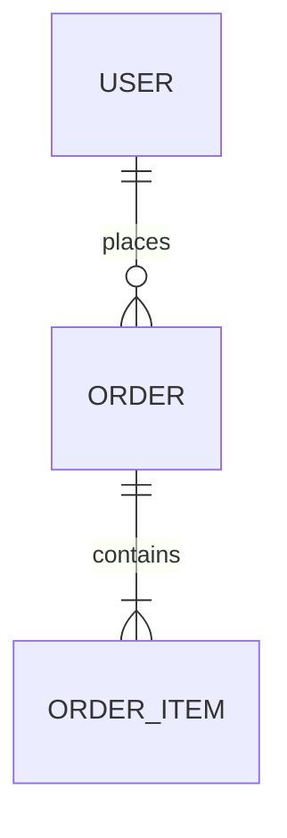

# DynamoDB Schema Workflow

Guide users through designing new or auditing existing DynamoDB schemas.

## Mode Selection

Ask: "Are you **designing a new** schema or **auditing an existing** one?"

- **New** → [Design Workflow](#design-workflow)
- **Existing** → [Audit Workflow](#audit-workflow)

---

## Design Workflow

### Step 1: Gather Access Patterns

Ask user to list ALL queries:

"List every query your application needs:
- Get [entity] by [key]
- List [entities] for [parent]
- Find [entities] where [condition]

Example: Get user by ID, List orders for user, Find orders by status"

### Step 2: Identify Entities and Relationships

From access patterns, document:
- **Entities**: User, Order, Product, etc.
- **Relationships**: 1:1, 1:N, M:N

**Generate ERD** to validate:



### Step 3: Design Primary Keys

Apply single-table design:

```
Entity: User       → PK: USER#<id>     SK: PROFILE
Entity: Order      → PK: USER#<id>     SK: ORDER#<orderId>
Entity: OrderItem  → PK: ORDER#<id>    SK: ITEM#<productId>
```

Validate each access pattern uses Query (not Scan).

### Step 4: Design GSIs

For patterns not served by primary key (see [GSI patterns](../patterns/references/patterns.md#gsi-overloading)):
- Use GSI overloading (GSI1PK, GSI1SK)
- Consider sparse GSIs for rare attributes
- Minimize GSI count (each costs write capacity)

### Step 5: Create Sample Data

Write example items to validate design:

```
| PK          | SK           | GSI1PK         | GSI1SK          |
|-------------|--------------|----------------|-----------------|
| USER#123    | PROFILE      | EMAIL#a@b.com  | USER#123        |
| USER#123    | ORDER#001    | STATUS#pending | DATE#2024-01-15 |
```

**Generate Table Layout** - see [diagrams reference](references/diagrams.md).

### Step 6: Verify All Patterns

Map each pattern to its query:

| Access Pattern | Table/Index | Query |
|---------------|-------------|-------|
| Get user | Base | PK=USER#id, SK=PROFILE |
| User's orders | Base | PK=USER#id, SK begins_with ORDER# |

**Every pattern must use Query, never Scan.**

### Step 7: Generate Schema

Output in user's preferred format: CDK, CloudFormation, Terraform, or AWS CLI.

---

## Audit Workflow

### Step 1: Locate Schema

Search for DynamoDB definitions:

```
Glob: **/*dynamodb*.ts, **/cdk*.ts, **/*.tf, **/template.yaml
Grep: "dynamodb.Table" or "AWS::DynamoDB" or "aws_dynamodb_table"
```

If not found, ask user to provide or describe their schema.

### Step 2: Parse Schema

Extract and confirm:
- Table name
- Primary key (PK + SK)
- GSI definitions
- Billing mode

"I found table X with PK=Y, SK=Z, and N GSIs. Correct?"

### Step 3: Gather Access Patterns

Ask: "What queries does your application perform? List each:
- Get/List/Find [what] by/for [condition]"

### Step 4: Map Patterns to Schema

For each access pattern, identify:
1. Which table/index serves it
2. Query or Scan operation
3. Filter expressions needed

Present mapping for review.

### Step 5: Analyze Against Best Practices

For detailed patterns, see [patterns reference](../patterns/references/patterns.md).

**Key Design**
- [ ] High-cardinality partition key?
- [ ] Effective sort key for ranges?
- [ ] Single-table design where appropriate?

**Access Efficiency**
- [ ] All patterns use Query?
- [ ] Filters doing key's work?

**GSI Health**
- [ ] Overloading used?
- [ ] Sparse GSI opportunities?

**Scalability**
- [ ] Hot partition risks?
- [ ] Write sharding needed?

### Step 6: Present Findings

```
## Audit Results

### Summary
Critical: X | Warnings: Y | Suggestions: Z

### Access Pattern Analysis
| Pattern | Method | Status |
|---------|--------|--------|

### Issues (prioritized)
1. [Critical] ...
2. [Warning] ...

### Recommended Actions
1. ...
```

### Step 7: Offer Next Steps

"Would you like me to:
1. Generate the improved schema?
2. Explain a specific recommendation?
3. Show migration approach?"

---

## Diagram Reference

See [references/diagrams.md](references/diagrams.md) for table layout templates and visualization options.
